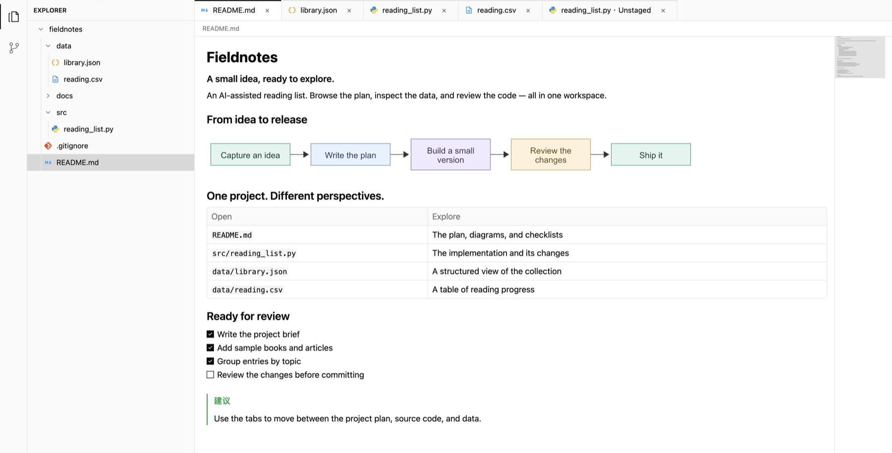
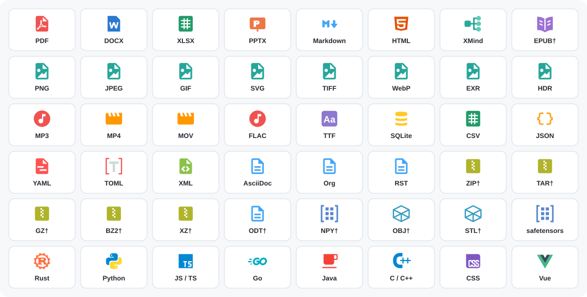

  

<h1 align="center">Glim</h1>

<strong>The all-purpose viewer for the AI era, opening a wide range of file formats in one app.</strong>

Free and open source · macOS &amp; Windows · <b>English</b> / <a href="README.zh-CN.md">简体中文</a>

  
  
  

<a href="https://github.com/NeoPanic/Glim/releases/latest">Current release: 0.1.13 · Release notes &amp; checksums</a> · <a href="#download">Installation help</a>

Mac downloads are not yet notarized by Apple. You may need to approve the first launch in System Settings. <a href="#macos">See instructions</a>

Different file formats in one tabbed workspace. Captured on macOS; click to zoom in.

  
  
  
  
  
  

## Supported file formats

<a href="docs/file-format-support.md">
  <picture>
    <source media="(prefers-color-scheme: dark)" srcset="assets/readme/formats-dark.svg" />
    <source media="(prefers-color-scheme: light)" srcset="assets/readme/formats.svg" />
    
  </picture>
</a>

*Selected formats: \* macOS only, † limited preview. Capabilities and limits are listed below and in the full format guide.*

| Content | What you can do |
| --- | --- |
| Documents | Markdown, static HTML, ordinary UTF-8 text, diagrams and formulas |
| Native documents · macOS | Read-only PDF, Word, Excel, PowerPoint, Keynote, Pages, Numbers, and RTF previews |
| Images | PNG, JPEG, WebP, animated GIF, SVG, multipage TIFF, BMP, ICO, ICNS, EXR / HDR |
| Media & tools · macOS | Audio/video and folder playlists; fonts and font collections; SQLite tables, schema, and associated WAL files |
| Mind maps | XMind previews with sheet switching, topic folding, zoom and topic details |
| Code & configuration | Rust, Python, JS/TS, Go, C/C++, Java, Swift, Ruby, INI, and more; syntax highlighting and basic text editing |
| Data | JSON / JSONC, CSV / TSV, YAML, TOML, SQL, GeoJSON and notebooks; trees, tables or text previews |
| AI model metadata | safetensors names, shapes, dtypes, and parameter counts, read from the header only |
| First-pass previews | AsciiDoc / Org / RST, subtitles, TSV / NDJSON / JSON5, D2 / Pikchr / Vega, OBJ / STL, archive listings and selected text previews, and more |

**Platform scope:** macOS and Windows both support the main code/text, Markdown/HTML, JSON, image, XMind, model-metadata, and Git workspace. Native PDF, Office/iWork, media, font, and SQLite previews, plus default file-type management, currently require macOS.

Format details and limits

Markdown includes Mermaid (flowcharts, subgraphs, Journey, Radar, and ZenUML), Graphviz/DOT, PlantUML (including partial Salt and Chen ER support), flowchart.js, WaveDrom, LaTeX, GFM tables, task lists, footnotes, GitHub Alerts, and frontmatter. Failed diagram blocks retain their source.

Text editing supports up to 32 MiB; larger files open in read-only pages. Optional full loading is limited to 256 MiB. Markdown supports 128 distinct diagram blocks per document. HTML preview is static and does not execute scripts. Archives support listings and selected text previews, rather than general extraction or full content rendering. Non-UTF-8 text is not currently decoded.

Office layout and media codecs depend on macOS support. XLS/XLSX previews show local tables and stored formula values; use the default application for complete styles, charts, or complex documents.

[Documentation](docs/README.md) · [Full format list and limits](docs/file-format-support.md) · [Roadmap](docs/TODO.md)

## Download

| Your device | Download Glim 0.1.13 |
| --- | --- |
| Mac · Apple Silicon (M series) | [Download ARM64 DMG](https://github.com/NeoPanic/Glim/releases/download/v0.1.13/Glim-0.1.13-macos-arm64.dmg) |
| Mac · Intel | [Download Intel DMG](https://github.com/NeoPanic/Glim/releases/download/v0.1.13/Glim-0.1.13-macos-x86_64.dmg) |
| Windows · Intel / AMD 64-bit | [Download x64 ZIP](https://github.com/NeoPanic/Glim/releases/download/v0.1.13/Glim-0.1.13-windows-x64.zip) |

Not sure which Mac download to choose? Open **Apple menu → About This Mac**. An Apple M-series chip means Apple Silicon; an Intel processor means Intel.

### macOS

Open the DMG and drag Glim into Applications. The app is ad-hoc signed, without Developer ID signing or notarization. If macOS blocks it, try opening it once, then go to **System Settings → Privacy & Security → Open Anyway**. Confirm the download came from this project's releases; there is no need to disable system security. [Apple's instructions](https://support.apple.com/en-us/102445).

### Windows

Extract the ZIP and run `Glim.exe`. Install [Git for Windows](https://gitforwindows.org/) to use Git features. The executable is not yet Authenticode signed. Requires DirectX 11; a Windows ARM build is not currently available. Shortcuts use Ctrl in place of the Mac's ⌘.

[Release notes & SHA-256 checksums](https://github.com/NeoPanic/Glim/releases/latest) · [All releases](https://github.com/NeoPanic/Glim/releases) · [Build from source](docs/releasing.md)

## Get involved

Found a file Glim should open better? [Report a bug](https://github.com/NeoPanic/Glim/issues/new?template=bug_report.yml), [request a format](https://github.com/NeoPanic/Glim/issues/new?template=feature_request.yml), or [start a discussion](https://github.com/NeoPanic/Glim/discussions). English and Chinese are welcome.

[Contributing](CONTRIBUTING.md) · [Build from source](docs/releasing.md) · [Roadmap](docs/TODO.md) · [Security](SECURITY.md) · [MIT License](LICENSE)

## Contributors

Thanks to everyone helping make Glim better.

## Star history

<a href="https://star-history.com/#NeoPanic/Glim&amp;Date">
  <picture>
    <source media="(prefers-color-scheme: dark)" srcset="https://api.star-history.com/svg?repos=NeoPanic/Glim&amp;type=Date&amp;theme=dark" />
    <source media="(prefers-color-scheme: light)" srcset="https://api.star-history.com/svg?repos=NeoPanic/Glim&amp;type=Date" />
    
  </picture>
</a>

## Download history

<a href="https://github.com/NeoPanic/Glim/tree/codex/download-stats">
  <picture>
    <source media="(prefers-color-scheme: dark)" srcset="https://raw.githubusercontent.com/NeoPanic/Glim/refs/heads/codex/download-stats/downloads-dark.svg" />
    <source media="(prefers-color-scheme: light)" srcset="https://raw.githubusercontent.com/NeoPanic/Glim/refs/heads/codex/download-stats/downloads.svg" />
    
  </picture>
</a>

Daily snapshots of cumulative public GitHub release-asset downloads, including installers, update feeds, checksums and release-verification requests. Tracking starts on **2026-10-12**; earlier history is unavailable. These counts are downloads, not unique users or installs.
