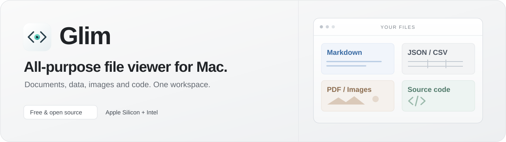

  

<a href="README.md">English</a> · <b>简体中文</b>

**The all-purpose viewer for the AI era.**

AI 时代的全能查看器。在一个原生桌面工作区里阅读代码、文档、数据和 Git 变更，检查 AI 生成的文件与模型元数据。免费开源，基于 Rust 和 GPUI。

## 下载与安装

| 设备 | Glim 0.1.10 |
| --- | --- |
| Mac · Apple Silicon（M 系列） | [下载 ARM64 DMG](https://github.com/NeoPanic/Glim/releases/download/v0.1.10/Glim-0.1.10-macos-arm64.dmg) |
| Mac · Intel | [下载 Intel DMG](https://github.com/NeoPanic/Glim/releases/download/v0.1.10/Glim-0.1.10-macos-x86_64.dmg) |
| Windows · Intel / AMD 64 位 | [下载 x64 ZIP](https://github.com/NeoPanic/Glim/releases/download/v0.1.10/Glim-0.1.10-windows-x64.zip) |

[最新版与 SHA-256 校验文件](https://github.com/NeoPanic/Glim/releases/latest) · [历史版本](https://github.com/NeoPanic/Glim/releases)

**macOS：** 打开 DMG，将 Glim 拖入“应用程序”。目前使用 ad-hoc 签名，**尚无 Developer ID 签名与 Apple 公证**。若系统拦截，先尝试打开一次，再到 **系统设置 → 隐私与安全性 → 仍要打开**。请确认安装包来自可信的项目发布页，无需关闭系统安全保护。[Apple 官方说明](https://support.apple.com/zh-cn/102445)

**Windows：** 解压 ZIP，运行 `Glim.exe`；Git 功能需要 [Git for Windows](https://gitforwindows.org/)。目前尚无 Authenticode 签名，需要 DirectX 11 图形环境；本次不包含 Windows ARM。快捷键使用 Ctrl，对应 Mac 的 ⌘。

## 支持的格式

| 内容 | 格式与体验 |
| --- | --- |
| 代码与配置 | Rust、Python、Go、JS/TS、C/C++/CUDA、Java、Swift、Ruby 等语法高亮；Dockerfile、`.env`、`.npmrc`、Jinja 等项目文件 |
| 文档与数据 | Markdown / 静态 HTML 排版预览；JSON/JSONC、GeoJSON 和 Notebook 源码高亮及折叠树；CSV 表格/原文切换；YAML、TOML、SQL、GraphQL 等 UTF-8 文本 |
| 图片 | PNG、JPEG、WebP、GIF 动画、SVG、多页 TIFF、BMP、ICO、ICNS、EXR、HDR |
| Git | 工作区与暂存区 diff、提交历史、Inline / 双栏比较 |
| AI 模型 | safetensors 的张量、shape、精度、参数量与元数据，仅读取头部、不加载权重 |
| 原生文档 · macOS | PDF、Word、Excel、PowerPoint、Keynote、Pages、Numbers、RTF 只读预览 |
| 媒体、字体与数据库 · macOS | 音视频播放与文件夹队列；TTF/OTF 等字体预览；SQLite 结构、分页记录及关联 WAL 文件 |

**Markdown 扩展：** 随应用提供离线 Mermaid（流程图/subgraph、Journey、Radar、ZenUML 等）、Graphviz/DOT、PlantUML（含常见 Salt、Chen ER 语法）、flowchart.js、WaveDrom 与 LaTeX 公式。支持 GFM 表格、任务列表、脚注、GitHub Alerts 和 frontmatter；失败块保留源码并显示错误。

**平台差异：** Windows 提供主工作区，包括代码/文本编辑、Markdown/HTML、JSON、图片、safetensors 元数据与 Git。PDF、Office/iWork、媒体、字体、SQLite 原生预览及默认文件类型管理目前仅 macOS 提供。

[完整格式与限制](docs/file-format-support.md)。Office 排版与媒体编码取决于系统支持；HTML 为静态预览，不执行脚本。暂不支持归档内容与非 UTF-8 文本。

## 核心功能

- **专注阅读与轻量编辑**：多文件夹、多标签、多窗口、文件搜索、折叠、Minimap、换行开关；普通文本自动保存，支持撤销/重做。
- **预览与源码自由切换**：Markdown / HTML 记住各自的阅读模式；JSON 同时提供源码高亮与可折叠树。
- **完整日常 Git 流程**：暂存、提交、分支、Fetch / Pull / Push / Stash；Graph 展开改动文件，Inline / 双栏查看 diff。Pull 仅快进。
- **工作空间恢复与双语界面**：启动恢复最近保存的工作空间目录；简体中文与 English 默认跟随系统，也可在菜单手动选择。关于菜单显示版本，快捷键入口提供 Mac/Windows 说明。
- **CSV 双模式**：虚拟化表格支持引号、跨行字段和不齐列，也可切换原文编辑。
- **大文件按需读取**：超过编辑预算进入只读分页，完整加载先确认并设上限；模型预览仅读取有限头部。
- **macOS 原生预览**：文档、字体、数据库与音视频独立窗口；包含媒体的文件夹可顺序/随机播放。可在 Glim → Default File Types… 管理默认打开方式。

文本编辑预算为 32 MiB，更大文件使用有界分页；可选完整加载上限 256 MiB。每篇 Markdown 支持 128 个不同图表块。macOS XLS/XLSX 使用本地表格预览、显示缓存公式值；完整图表和原始样式可在默认应用查看。

## 参与项目

[报告问题](https://github.com/NeoPanic/Glim/issues/new?template=bug_report.yml) · [申请格式或功能](https://github.com/NeoPanic/Glim/issues/new?template=feature_request.yml) · [讨论与交流](https://github.com/NeoPanic/Glim/discussions)，欢迎中文和英文。

[贡献指南](CONTRIBUTING.md) · [构建说明](docs/releasing.md) · [未完成计划](docs/TODO.md) · [安全政策](SECURITY.md) · [MIT License](LICENSE)
