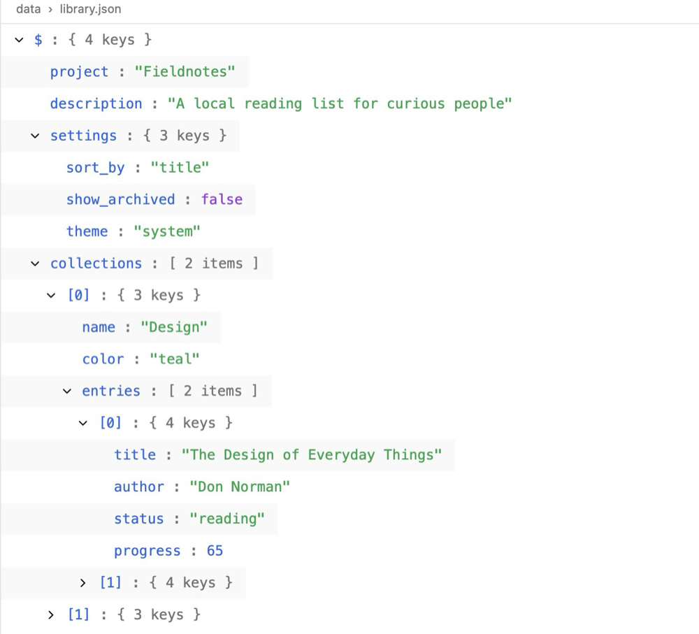
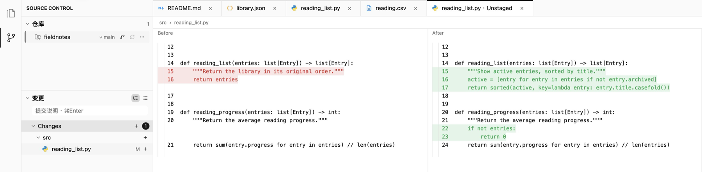

  

<h1 align="center">Glim</h1>

<strong>代码、文档、数据和 Git 改动，一个桌面工作区。</strong> 
阅读 AI 生成的项目，预览 Markdown 图表，检查提交前的每一处改动。

免费开源 · macOS 与 Windows · <a href="README.md">English</a> / <b>简体中文</b>

  
  
  

<a href="https://github.com/NeoPanic/Glim/releases/latest">当前版本 0.1.11 · 更新说明与校验文件</a> · <a href="#下载与安装">安装帮助</a>

Mac 下载包目前尚未经过 Apple 公证，首次打开可能需要在系统设置中放行。<a href="#macos">查看步骤</a>

macOS 实际界面：同一个项目里的说明、代码和数据，随时切换查看。点击图片可放大。

  
  
  
  
  
  

## 三个值得打开 Glim 的时刻

### 读懂 AI 刚生成的项目

打开文件夹，先读项目说明，再切到代码和配置。Markdown 里的 Mermaid 流程图、LaTeX 公式、表格与任务列表直接渲染，图表引擎随应用离线提供。普通文本可以就地修改，支持撤销、重做和自动保存。

### 看清数据，而不只是看见一大段文本

JSON 可以在源码和可折叠树之间切换，CSV 可以切换为表格。检查配置、接口样例或导出的数据时，结构更容易看清。safetensors 还能直接查看张量、维度和参数量，无需加载模型权重。

### 提交之前，看清到底改了什么

从文件浏览切到 Git，查看工作区或暂存区的差异，按需要选择单栏或双栏对比。暂存、取消暂存和提交都有明确入口，也可以浏览提交历史中的文件变化。

## 下载与安装

| 你的设备 | 下载 Glim 0.1.11 |
| --- | --- |
| Mac · Apple Silicon（M 系列） | [下载 ARM64 DMG](https://github.com/NeoPanic/Glim/releases/download/v0.1.11/Glim-0.1.11-macos-arm64.dmg) |
| Mac · Intel | [下载 Intel DMG](https://github.com/NeoPanic/Glim/releases/download/v0.1.11/Glim-0.1.11-macos-x86_64.dmg) |
| Windows · Intel / AMD 64 位 | [下载 x64 ZIP](https://github.com/NeoPanic/Glim/releases/download/v0.1.11/Glim-0.1.11-windows-x64.zip) |

不确定 Mac 的类型？打开 **苹果菜单 → 关于本机**：看到 Apple M 系列芯片就选 Apple Silicon，看到 Intel 处理器就选 Intel。

### macOS

打开 DMG，将 Glim 拖入“应用程序”。目前使用 ad-hoc 签名，尚无 Developer ID 签名与 Apple 公证。若系统拦截，先尝试打开一次，再到 **系统设置 → 隐私与安全性 → 仍要打开**。请确认安装包来自本项目发布页，无需关闭系统安全保护。[Apple 官方说明](https://support.apple.com/zh-cn/102445)

### Windows

解压 ZIP，运行 `Glim.exe`。Git 功能需要 [Git for Windows](https://gitforwindows.org/)。目前尚无 Authenticode 签名，需要 DirectX 11 图形环境；暂不提供 Windows ARM 安装包。快捷键使用 Ctrl，对应 Mac 的 ⌘。

[更新说明与 SHA-256 校验文件](https://github.com/NeoPanic/Glim/releases/latest) · [历史版本](https://github.com/NeoPanic/Glim/releases) · [从源码构建](docs/releasing.md)

## 支持哪些内容？

| 内容 | 可以做什么 |
| --- | --- |
| 代码与配置 | Rust、Python、JS/TS、Go、C/C++、Java、Swift、Ruby 等语法高亮；文件搜索、折叠、Minimap、轻量编辑 |
| 文档 | Markdown / 静态 HTML 预览；Markdown 离线图表和公式；普通 UTF-8 文本阅读与编辑 |
| 数据 | JSON / JSONC 可折叠树、CSV 表格、YAML / TOML / SQL；GeoJSON 和 Notebook 的源码与结构 |
| 图片 | PNG、JPEG、WebP、GIF 动画、SVG、多页 TIFF、BMP、ICO、ICNS、EXR / HDR |
| Git | 工作区和暂存区差异、单栏 / 双栏比较、暂存与提交、分支及提交历史 |
| AI 模型元数据 | safetensors 张量名称、shape、精度和参数量，仅读取头部 |
| 原生文档 · macOS | PDF、Word、Excel、PowerPoint、Keynote、Pages、Numbers、RTF 只读预览 |
| 媒体与工具 · macOS | 音视频播放与文件夹队列；字体及字体集合；SQLite 表、结构和关联 WAL 文件 |
| 探索格式首轮 | AsciiDoc / Org / RST、字幕、TSV / NDJSON / JSON5、D2 / Pikchr / Vega、OBJ / STL、归档目录与部分文本预览等 |

**平台范围：** macOS 和 Windows 都支持代码/文本、Markdown/HTML、JSON、图片、模型元数据和 Git 工作区。PDF、Office/iWork、音视频、字体、SQLite 原生预览及默认文件类型管理目前仅支持 macOS。

展开查看 Markdown 扩展与主要限制

Markdown 提供 Mermaid（含流程图、子图、Journey、Radar、ZenUML）、Graphviz/DOT、PlantUML（含部分 Salt 与 Chen ER 语法）、flowchart.js、WaveDrom、LaTeX，以及 GFM 表格、任务列表、脚注、GitHub Alerts 和 frontmatter。图表失败时保留源码。

普通文本编辑预算为 32 MiB，更大文件使用只读分页；可选完整加载上限 256 MiB。每篇 Markdown 支持 128 个不同图表块。HTML 为静态预览，不执行脚本。归档支持目录及选定格式的文本预览，不提供通用解压或完整内容渲染；非 UTF-8 文本暂不提供文字解码。

Office 排版和音视频编码支持取决于 macOS。XLS/XLSX 显示本地表格及缓存公式值；完整样式、图表和复杂文档可通过默认应用查看。

[完整格式与限制](docs/file-format-support.md) · [未完成计划](docs/TODO.md)

## 参与项目

[报告问题](https://github.com/NeoPanic/Glim/issues/new?template=bug_report.yml) · [申请格式或功能](https://github.com/NeoPanic/Glim/issues/new?template=feature_request.yml) · [讨论与交流](https://github.com/NeoPanic/Glim/discussions)，欢迎中文和英文。

[贡献指南](CONTRIBUTING.md) · [构建说明](docs/releasing.md) · [未完成计划](docs/TODO.md) · [安全政策](SECURITY.md) · [MIT License](LICENSE)

## 贡献者

感谢每一位帮助 Glim 变得更好的贡献者。

## Star 增长曲线

<a href="https://star-history.com/#NeoPanic/Glim&amp;Date">
  <picture>
    <source media="(prefers-color-scheme: dark)" srcset="https://api.star-history.com/svg?repos=NeoPanic/Glim&amp;type=Date&amp;theme=dark" />
    <source media="(prefers-color-scheme: light)" srcset="https://api.star-history.com/svg?repos=NeoPanic/Glim&amp;type=Date" />
    
  </picture>
</a>
