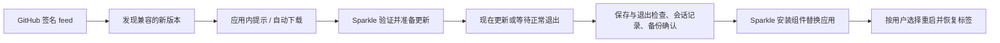

# Glim 自动更新设计

状态：macOS 客户端、签名 feed 生成与 draft Release 工作流已接入代码；发行构建从 GitHub 仓库变量读取公钥，受保护的 release 环境提供签名私钥。Windows 当前提供手动下载入口，自动安装需要独立后端。部署步骤见[构建与发布](releasing.md#自动更新配置)。

## 技术方案

采用 **GitHub Releases + Sparkle 2.10.0 + Glim 应用内更新界面**。Sparkle 版本来自官方当前稳定 Release；实际接入固定版本和下载 SHA-256，不跟随 `latest` 拉取构建依赖。

GitHub 托管签名后的安装包和更新清单；Sparkle 负责检查、下载、验证、解包、安装权限、替换和重启；Glim 负责提示、用户选择、工作状态保护及备份。使用 `SPUUpdater` 和自定义 `SPUUserDriver`，把界面放入 GPUI 更新面板。所有窗口共享一个更新协调器，不为每个工作台启动更新器，也不创建新的 Dock 应用。

当前实现：

- `v*` tag 触发 macOS arm64、macOS x86_64 和 Windows x64 构建；受保护的发布工作流组装并验证签名 Release 草稿。
- macOS DMG 使用 ad-hoc 应用签名，更新包与 feed 使用 Ed25519 验签；尚无 Developer ID 或 Apple 公证。
- `CFBundleShortVersionString` 为 `0.1.13`，`CFBundleVersion` 为 `14`；后者在正式版本中严格递增。
- 更新退出检查覆盖未保存内容、保存、Git 操作和待打开文件；会话记录恢复标签及预览模式，不恢复未保存草稿或自动播放媒体。

## 用户体验

入口为「Glim → 检查更新…」、关于页面和标题栏中的「有更新」提示。查看详情、下载进度、出错重试都使用同一个应用内面板。界面跟随中英文设置，颜色使用主题令牌。默认不申请系统通知权限，也不在用户编辑、播放或操作 Git 时抢焦点。

| 更新模式 | 检查 | 下载 | 安装时机 |
| --- | --- | --- | --- |
| 仅手动 | 用户点击检查更新 | 用户确认 | 用户选择现在重启或正常退出时安装 |
| 自动检查并提示（默认） | 每 24 小时由 Sparkle 调度 | 用户确认 | 同上 |
| 自动更新（主动开启） | 每 24 小时 | 后台下载并验证 | 正常退出时安装；可主动点击「现在重启更新」 |

在设置中明确显示默认模式及其网络行为，用户可随时切换。自动更新代表自动下载安装，但不代表允许中断工作、强制重启、强制结束进程或自动输入管理员凭据。主程序退出后不运行常驻检查进程；已安排的安装由短生命周期的 Sparkle 安装组件完成。

发现新版本时显示当前版本、可用版本、发布日期、包大小和中英文说明。提供「下载更新」「稍后提醒」「跳过此版本」。同一版本不在每次启动时重复弹窗，标题栏保留可操作入口；主动检查可重新展示跳过的版本。

下载就绪后显示「更新已就绪」「现在重启更新」「退出时安装」「取消本次更新」。必须区分：

- 「稍后提醒」用于尚未开始安装流程的版本提醒。
- 「退出时安装」明确表示本次正常退出后会替换应用。
- 「取消本次更新」要取消已安排的安装，不能仅关闭面板。Sparkle 的 `Dismiss` 在某些阶段仍会在退出后安装，不能直接映射成“取消”；`Skip` 在安装阶段也不等同于永久跳过该版本。实现必须按 `SPUUserUpdateState.stage` 映射操作并测试。

后台检查失败只在更新面板记录原因与上次成功检查时间；用户主动检查失败则立即给出可重试提示。手动下载入口始终指向项目正式 Release 页面。

## GitHub 托管与版本规则

不要求客户端登录 GitHub，也不嵌入访问令牌。运行时使用公开 Release 下载地址，不依赖 Releases API 的匿名配额。

每次正式 Release 增加两个稳定名称的签名 feed：

```text
https://github.com/NeoPanic/Glim/releases/latest/download/appcast-macos-arm64.xml
https://github.com/NeoPanic/Glim/releases/latest/download/appcast-macos-x86_64.xml
```

这些地址在首个签名更新 Release 发布后才生效，代码接入不代表远端服务已部署。feed 的下载项指向不可变的带 tag 安装包地址，例如：

```text
https://github.com/NeoPanic/Glim/releases/download/v0.1.12/Glim-0.1.12-macos-arm64.dmg
```

继续使用已有 DMG 作为首期完整更新包，不另造重复的 ZIP 分发链路。feed 包含显示版本、严格递增的 bundle build、最小系统版本、下载 URL、字节数、EdDSA 签名和发布说明。清单内保留支持不同 macOS 版本的历史条目，使旧系统可以找到仍兼容的版本。

每个架构的应用包内写入自己的 `SUFeedURL`。依据已安装应用的架构选择 feed；Rosetta 下的 Intel 安装仍走 Intel feed，避免隐式切换架构。最低系统版本必须来自构建配置和产物验证，不能凭当前开发机版本推断。

首期仅接收正式稳定版；draft、prerelease、缺失产物的版本不进入 stable feed。必须先准备完整 Release，再标记为 Latest。版本只允许前进；修复坏版本发布更高 build，不能覆盖同一个 tag 的旧安装包。历史源代码重新发布为修复包时，也使用更高 build。

## 签名与安装可信度

使用 Sparkle 的 Ed25519 更新签名。公钥随应用分发，私钥只用于受保护的发布签名环境，并有离线恢复副本。仓库、客户端、PR 工作流及公共构建日志均不包含私钥。

正式更新包使用以下默认配置：

| Info.plist 配置 | 值 / 用途 |
| --- | --- |
| `SUFeedURL` | 当前发行架构的稳定 feed |
| `SUPublicEDKey` | 项目固定更新公钥 |
| `SUEnableAutomaticChecks` | `true`，默认检查并提示 |
| `SUScheduledCheckInterval` | `86400` 秒 |
| `SUAutomaticallyUpdate` | `false`，自动下载安装由用户主动开启 |
| `SUEnableSystemProfiling` | `false` |
| `SUVerifyUpdateBeforeExtraction` | `true`，先验证更新包再解包 |
| `SURequireSignedFeed` | `true`，同时验证 feed 和发布说明 |
| `SUSignedFeedFailureExpirationInterval` | `0`，不因长期失败放宽 feed 验证 |

通过固定版本 Sparkle 工具生成并签署 feed；中英文说明嵌入签名 feed，避免显示与包不一致的未签名说明。发布流水线只接受签名后的原始文件，不能上传后再改写 XML 或说明内容。

SHA-256 继续提供给手动下载者并用于 CI 校验，但“安装包与旁边的校验文件一致”不构成发布者身份认证。EdDSA 验证和 Apple Developer ID / 公证是不同层次：当前 ad-hoc 分发可以规划 EdDSA 更新链路，但首次安装的 Gatekeeper 体验仍需真实测试；Developer ID 和公证是推荐的正式分发目标。更新器不得通过移除 quarantine 或关闭系统保护来规避问题。

严格验签模式下，丢失更新私钥的恢复路径必须提前约定。特别是在没有 Developer ID 的情况下，可能需要用户重新手动安装可信的新版本来建立新信任链，不能承诺无条件在线换钥。

## 安装事务与工作保护



应用范围的 `UpdateCoordinator` 负责一次安装事务，所有窗口共享。一个安装目录同一时间只允许一个事务；若同一 `.app` 还存在其他运行实例，提示用户退出其他实例，不强制结束它们。

安装前必须满足：

1. 下载及签名验证成功，目标版本、bundle identity、架构、最低系统版本匹配，安装目标为当前实际运行的应用包。
2. 更新当前运行版本的恢复备份已完成并可读。备份在后台、进入可能安排安装的更新流程前准备，同一 build 与内容指纹的备份可复用；不能等 `willInstallUpdate` 或退出回调才开始长时间复制。
3. 所有工作台完成显式选择的保存操作，等待已启动的自动保存与 Git 操作结束。任何冲突、保存失败或用户取消都会阻止此次重启，不自动丢弃草稿。
4. 临时禁止新编辑、新 Git 写入和改变安装目标的操作，重新检查条件，避免检查通过后状态又变化。延迟或取消时解除限制。
5. 会话记录落盘成功，随后才能调用安装 / 重启的 continuation；每个 continuation 只完成一次，不在后台任务取消或实体销毁后调用。

**退出检查必须发生在原生安装回调之前。** GPUI 的 `on_app_quit` 明确不能取消退出，且会清理窗口；它只用于最后的收尾。当前 `request_quit` 也不能被当作可直接回调的布尔检查，需要重构为能返回“允许 / 延迟 / 取消”的退出协调器。

自定义 `SPUUserDriver` 的 `showReadyToInstallAndRelaunch`、已处于 installing 阶段的继续安装操作及重试终止操作，均先经过上述协调器。`shouldPostponeRelaunchForUpdate` 作为补充。原生桥接还为当前固定 GPUI 的应用 delegate 添加其缺少的 `applicationShouldTerminate:`，在待安装时取消未经批准的系统退出并交回 Rust 检查；保留原 delegate 的身份与生命周期方法，若未来 GPUI 已提供不同退出契约则关闭自动更新能力。自动更新不调用主动终止回调，只等用户正常退出；所有由 Glim 控制的退出入口须使用同一检查流程。操作系统强制结束进程不承诺保留尚未持久化的内存内容。

保留 `io.github.jony4.glimpse` bundle identifier，避免破坏已有文件关联、更新身份和偏好。替换当前实际安装位置的整个应用包，包括内嵌框架和 Helpers，不只覆盖可执行文件。Sparkle 负责安装阶段的文件替换、权限交互和重启；不编写 `sleep + rm + cp` 自更新脚本。

可写安装目录不额外索取权限；需要授权时交给系统原生流程。用户取消授权则保留旧版本和可重试状态。应用从 DMG、只读卷或 translocation 环境运行时，提示先安装到可写的 Applications 位置，不往只读包中写入，也不静默改变安装位置。

## 恢复与失败行为

更新前保存一次性会话清单：工作空间根目录、文件标签顺序、当前标签、预览/源码模式、可恢复的 diff 标识。重新打开走现有后台加载与标签去重流程；文件已移动或删除时给出可关闭的错误标签。首期不把未保存正文当作普通会话配置，也不自动恢复音视频播放；有草稿时先解决保存或由用户明确选择放弃。

备份放入 `~/Library/Application Support/Glim/UpdateBackups/`，按版本和事务编号保存归档，原有用户配置独立保留。至少保留最近一个确认可运行版本；新版本尚未完成首次成功启动时，不删除其前一个备份。设置提供「显示恢复备份」和操作说明。

| 失败场景 | 行为 |
| --- | --- |
| GitHub 不可达、请求超时、清单暂时缺失 | 保留当前应用；稍后重试，主动检查显示错误 |
| 签名无效、包损坏、架构或系统不匹配 | 拒绝安装；不开放“忽略验证”按钮 |
| 下载中断或用户取消下载 | 结束当前请求，保留可重试状态；断点续传以所固定 Sparkle 版本的实测支持为准 |
| 空间不足、备份失败 | 安装前中止，不删除现有应用以腾空间 |
| 保存冲突、Git 操作未结束、用户取消退出 | 保留当前会话和待更新状态，解除临时操作限制 |
| 安装权限不足、授权取消、替换失败 | 展示 Sparkle 的实际结果，保留恢复备份与手动安装入口 |
| 新版本成功安装但自身崩溃 | 通过保留的可信备份手动恢复；不把一次崩溃判定成必须自动降级 |

首期提供可恢复备份，历史备份暂不自动清理，可从更新面板显示备份位置后手动管理。不宣称 Sparkle 自带基于启动健康检查的自动回滚。自动恢复助手属于后续独立功能，需另行解决误判、配置迁移兼容性和回滚循环。

## 与现有代码的衔接

代码模块职责如下：

| 位置 | 职责 |
| --- | --- |
| `glim-core/src/update.rs` | 更新状态、模式、退出检查结果等无 I/O 数据类型 |
| `glim-services/src/updates.rs` | 备份、会话清单、安装目录检查和恢复信息；不导入 GPUI |
| `glim-app/src/app/updates.rs` | 一个全局协调器、动作、所有工作台的保存/Git 检查、退出 continuation |
| `glim-app/src/views/updates.rs` | 共用更新面板、提示、进度与设置 |
| `native/Updater.swift` 及专用 Rust bridge | 持久化的 Sparkle 控制器、自定义 user driver、主线程事件桥接 |
| `app/mod.rs`、关于页面、工作台标题栏 | 薄的初始化及入口接线 |
| `scripts/bundle-macos.sh`、`package-dmg.sh` | 嵌入框架、架构 feed、公钥、嵌套签名及最终 DMG 签名信息 |
| GitHub 发布工作流 | 收集产物、签署安装包和 feed、组装完整 draft Release |

Rust crate 依赖方向保持 `app → services → core`。Sparkle 的原生 I/O 由框架管理；应用自有文件操作放在 services 后台任务中。Swift 控制器和 GPUI 状态实体跨 render 存活；FFI 只在独立小模块内允许 unsafe，事件传回 UI 线程。任务、订阅和原生回调均由协调器持有并在退出时清理。

按 macOS 发行构建接入 Sparkle.framework，保留 framework symlink、执行权限和随附安装组件；包内使用相对 rpath，先签嵌套组件，再签外层应用。保留 Sparkle 许可说明。普通 `cargo run` 和未配置正式 feed / 公钥的本地构建默认禁用真实更新，防止覆盖开发者自己的构建。

更新模式由 Sparkle 的设置 API 持久化，GPUI 界面读取同一份状态，避免两套偏好互相覆盖。应用自有的会话与备份记录单独持久化。发布版本显示来自 bundle；源代码构建可回退到 Cargo 版本，不能让本地同号改动自动覆盖正式包或被误识别为更高版本。

## 发布工作流

1. 维护者更新 Cargo 版本、显示版本和严格递增的 build，推送 `vX.Y.Z` tag。
2. 原有矩阵构建并验证三平台产物；macOS 打包时写入架构 feed 和公钥，嵌入已固定的 Sparkle。
3. 受保护的发布任务收集同一个提交的产物，检查版本、架构、系统要求、嵌套签名和校验值。
4. 从已有可信 feed 继承兼容版本历史，生成新条目及等价中英文说明，用发布私钥签署 DMG、feed 和必要的说明资源。签名后不再修改这些文件。
5. 将所有安装包、SHA-256 和两个 feed 一次性加入 draft Release，并对上传字节再次验证；任何必需产物或签名缺失都保留 draft 状态。
6. 维护者发布正式 Release 并标记 Latest。客户端随后通过稳定 URL 发现更新。保留当前项目“公开发布由维护者决定”的方式，不因任意构建成功直接发布。

首期不添加 delta 更新或 beta 频道。后续可在稳定完整包链路通过后，逐步引入灰度和增量包，完整包始终保留。

## 实施顺序与验收

**第一步：集成验证。** 先制作两个本地测试发行版本，验证固定 Sparkle、GPUI 自定义 user driver、退出检查、嵌套框架签名及安装位置。必须证明未保存文件 / 保存失败 / Git 进行中不会被更新重启绕过，才能启用自动安装。

**第二步：完整手动更新。** 实现默认自动检查、应用内提醒、用户确认下载、保存与备份、手动重启更新、错误提示和一次性会话恢复；接入 draft Release 的签名 feed。

**第三步：可选自动更新。** 使用同一安装链路增加主动开启的后台下载及正常退出时安装。补齐取消待安装更新、授权失败和多实例冲突的处理。

验收覆盖 arm64 与 Intel，以及：跨两个真实版本升级；从 Finder 启动 / 多窗口；文本与原生预览标签恢复；未保存内容、保存冲突、活跃 Git；拒绝授权；包损坏和错误签名；离线及下载取消；空间不足；DMG/只读运行；退出后安装与主动重启；升级中断后的旧版恢复。Rust 变更按仓库要求运行 fmt、Clippy、测试和构建，原生更新流程另用隔离安装目录及测试签名密钥验证。

已发布且不含更新器的 `0.1.11` 不会凭空获得检查能力：用户需要手动安装一次首个带更新器的版本，之后才能走这套链路。这也是项目应在该版本 Release 说明中明确的升级步骤。

Windows 首期在同一产品入口提供版本信息和对应 Release 下载。要实现自动替换，需要另行设计有签名的 Windows 安装/更新格式及独立进程处理文件占用，不能把现有便携 ZIP 当作已具备自更新能力。

## 官方参考

- [Sparkle 2.10.0 稳定 Release](https://github.com/sparkle-project/Sparkle/releases/tag/2.10.0)
- [基本集成、更新包及 feed 签名](https://sparkle-project.org/documentation/)
- [发布 appcast 与安装包](https://sparkle-project.org/documentation/publishing/)
- [检查周期、自动安装与验签配置](https://sparkle-project.org/documentation/customization/)
- [程序化接入与调度规则](https://sparkle-project.org/documentation/programmatic-setup/)
- [自定义 SPUUserDriver 与安装状态语义](https://sparkle-project.org/documentation/api-reference/Protocols/SPUUserDriver.html)
- [退出、安装和重启委托的边界](https://sparkle-project.org/documentation/api-reference/Protocols/SPUUpdaterDelegate.html)
